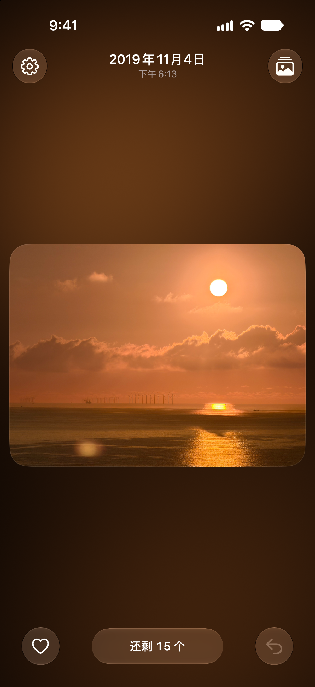
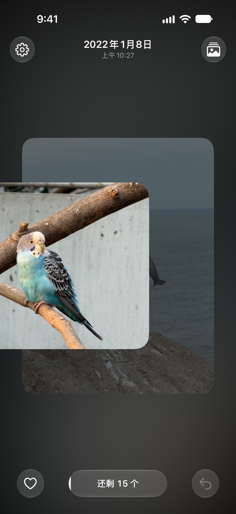
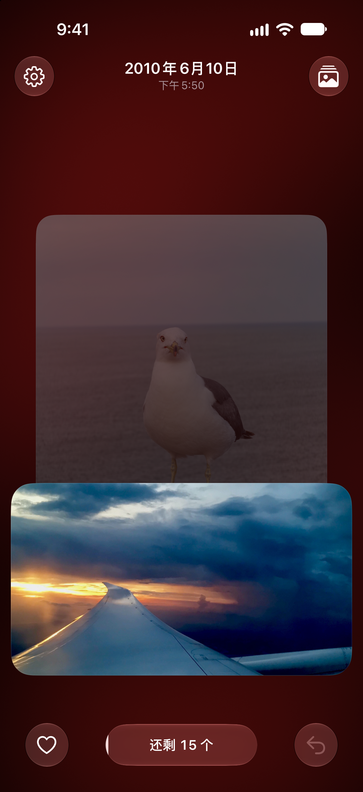
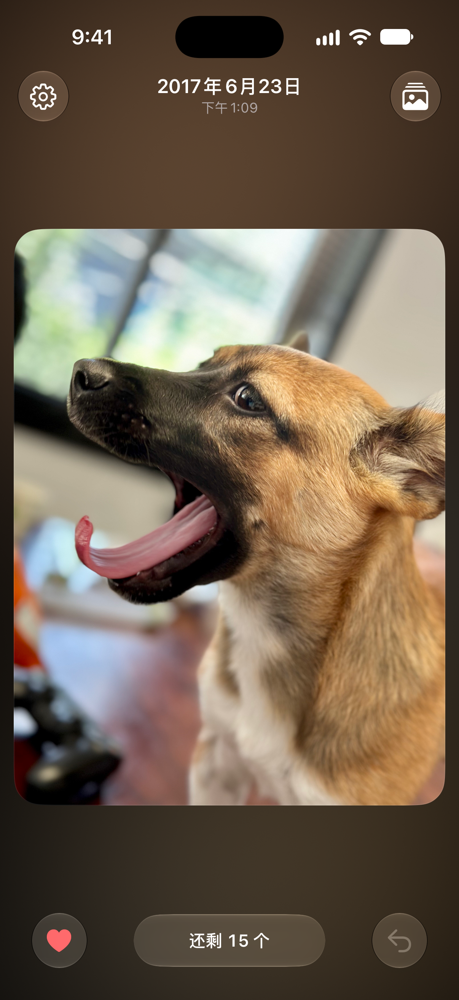

# Oushi · 偶拾

Flip through your photo library one card at a time. Oushi draws a random batch of photos and videos; swipe sideways to keep one, pull down to queue it for deletion, then review the queue and delete for real. Nothing comes up twice until you have been through the whole library.

[中文说明](README.zh-Hans.md)

<p>
  
  
  
  
</p>

## Features

- Batches of 15 to 50 photos and videos, or an unlimited batch, in random order, newest first, or oldest first
- Swipe sideways to keep, pull down to queue for deletion, undo any step
- A deletion queue that keeps everything in the library until you confirm; restore or delete some or all
- Favorites written straight to the Photos app
- Videos play on their cards; HDR photos and videos; haptic feedback
- Optional iCloud sync of the review history between your own devices (never the photos themselves)
- 20 languages

## Status

This repository is the complete source of Oushi, published as a baseline for anyone who wants to build something like it. Development happens in the author’s private repository, and new versions are brought over here from time to time, not necessarily with every release, so this code can be behind the App Store version. Issues and pull requests are not reviewed. You may maintain your own fork. The license applies to the code published here.

## Requirements

- Xcode 27 or later; the app targets iOS 26
- iOS 26 or later on the device or simulator

## Building

1. Open `App/偶拾.xcodeproj` and select the **Oushi** scheme.
2. The project ships with no development team. Copy `App/Config/Local.xcconfig.example` to `App/Config/Local.xcconfig` and put your team ID there (or choose it under *Signing & Capabilities*).
3. `App/Config/Identity.xcconfig` holds placeholder values for the bundle identifier, the iCloud container and the website the About screen links to (support, privacy policy, terms of use). Set them to your own; the entitlements, Info.plist and code all read them from there. A device build needs an iCloud container your team owns, or the iCloud capability removed: Xcode cannot provision another team's container. In the simulator the project builds as it is.
4. Build and run.

Before publishing your own app, replace the product name and icon. Private builds do not require that change.

`swift test --package-path App/OushiCore` runs the review logic’s tests on the Mac.

## Project layout

```
App/Config/     build settings (xcconfig); Identity.xcconfig holds the bundle identifier, iCloud container and
                website, Local.xcconfig (not in git) the development team
App/OushiCore/  Swift package: the review ledger (what was seen, what is queued), the batch, the SwiftData
                store and its iCloud mirror, the session, swipe physics; with its tests
App/Oushi/
  App/          app entry and root view
  Library/      PhotoKit access, image loading, favorites, identifier lookups
  Review/       the deck, the lessons, the cards, the bars, video playback, settings
  Pending/      the deletion queue card and the screen it grows into
  Background/   the photo-lit ground (Metal shader)
  Shared/       motion tokens, frame clock, controls, simulator-only screenshot poses
  Resources/    string catalogs, generated from Localization/
Localization/   source strings (keys.json) and one file per language; build_catalog.py writes the catalogs
                and checks them against the code
Screenshots/    plain simulator captures
```

## Localization

Strings are keyed by their Simplified Chinese text. `Localization/keys.json` holds every key with its English translation and a note on where it appears; `Localization/<language>.json` holds that language’s translations. Run `python3 Localization/build_catalog.py` after editing to regenerate `App/Oushi/Resources/*.xcstrings`; it also checks that format placeholders match.

## License

Copyright © 2026 Zuming Hu.

The code and documentation use GNU GPL version 3 with additional permission and terms under section 7. Read [LICENSE](LICENSE) and [ADDITIONAL-TERMS.md](ADDITIONAL-TERMS.md). Names and identified artwork have separate terms in [BRANDING.md](BRANDING.md).

- **Private use:** You may run and modify privately without publishing changes or adding a public attribution page.
- **Distribution:** Distribute the original or works based on its code under the GPL and applicable additional terms, regardless of price, channel or target platform. Porting or translating code does not remove these obligations.
- **Source:** Provide the complete Corresponding Source of the version you distribute as the GPL requires. A link to the original repository is not a substitute for your modified source. The GPL does not always require publication to the general public.
- **Attribution:** Retain the original project name, 偶拾 (Oushi); the original author, Zuming Hu; and the original repository address. In interactive works, show these on a legal-notices page accessible within the app; otherwise retain them in accompanying notices or documentation. Mark versions that have actually been modified.
- **Names and icon:** Use your own name and icon for your own app. You may name Oushi in attribution and truthful descriptions of the original project. Do not impersonate the original or imply its author's endorsement.

This summary does not replace the full terms. See section 6 of the additional terms for the app-store permission. An independent implementation is not covered merely because its features are similar.

The app includes offline copies of the full license files. After editing the root license files, run `python3 Tools/sync_legal.py` to update the bundled copies, or `python3 Tools/sync_legal.py --check` to verify them.
